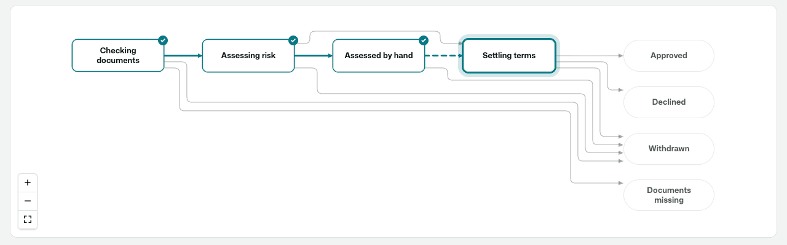
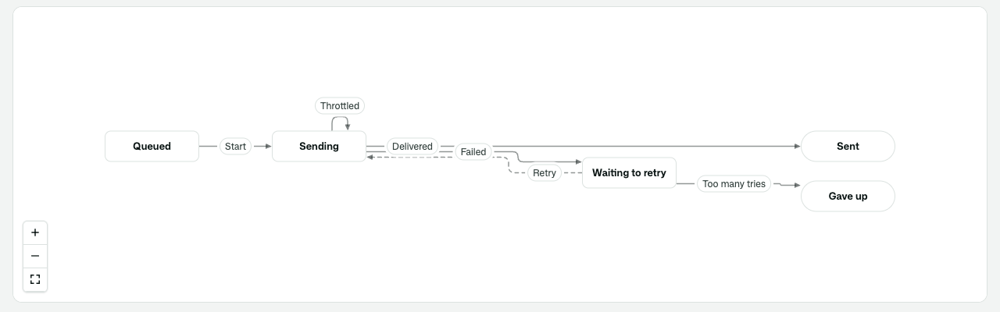
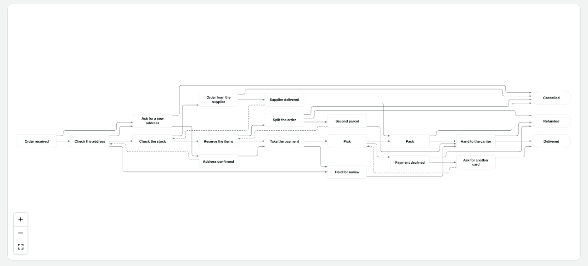
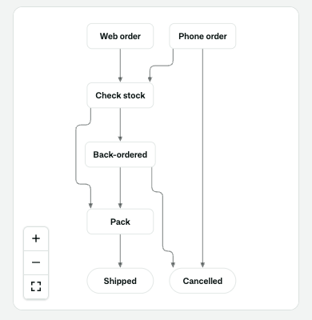
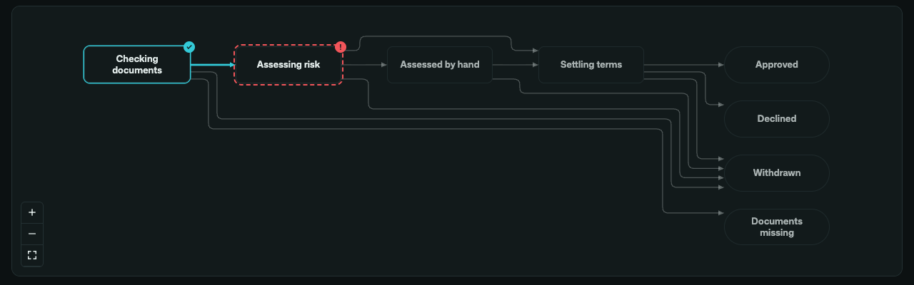
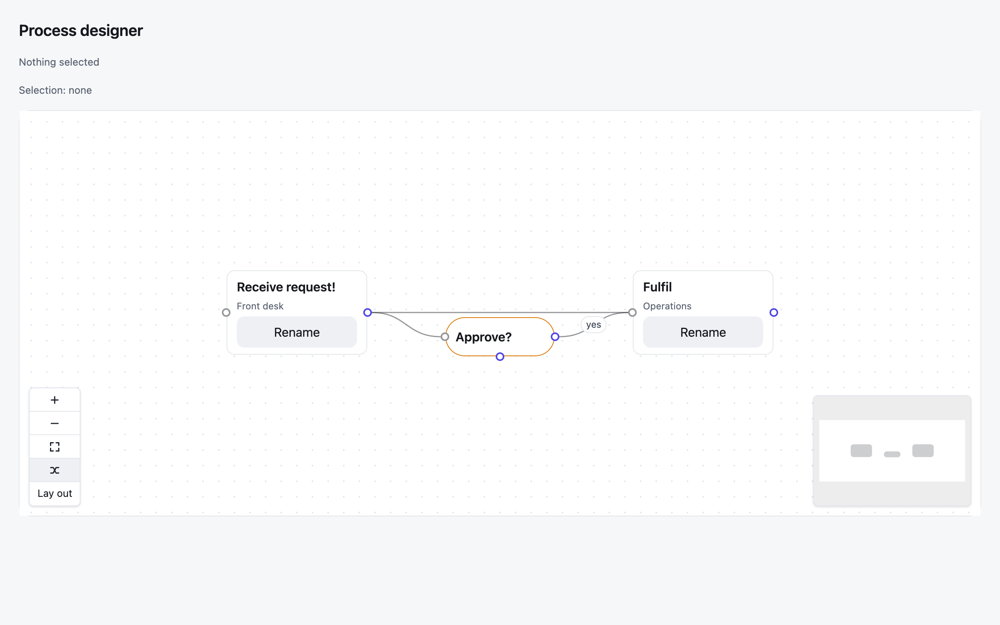
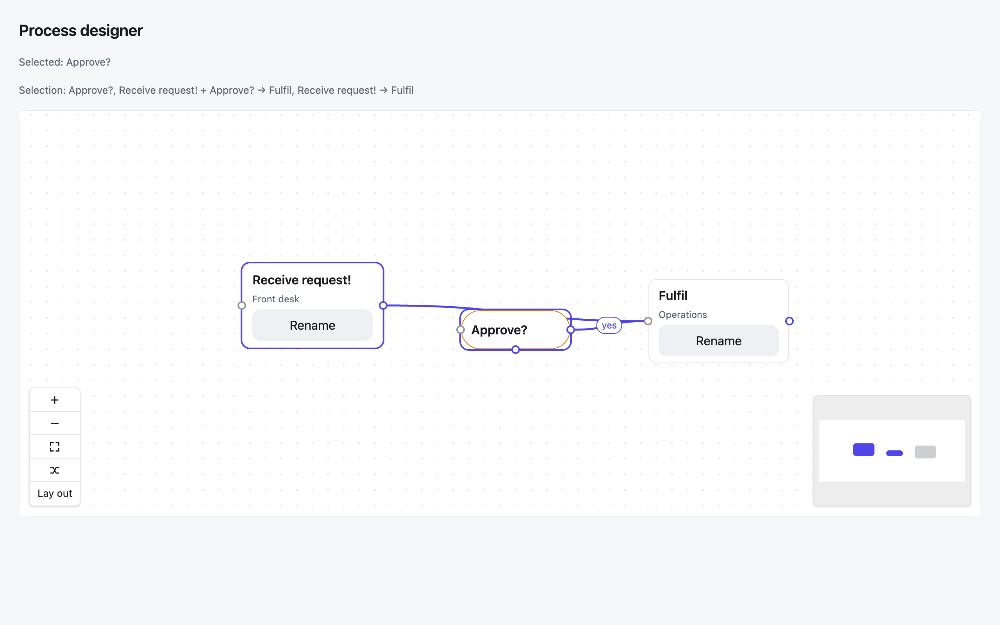
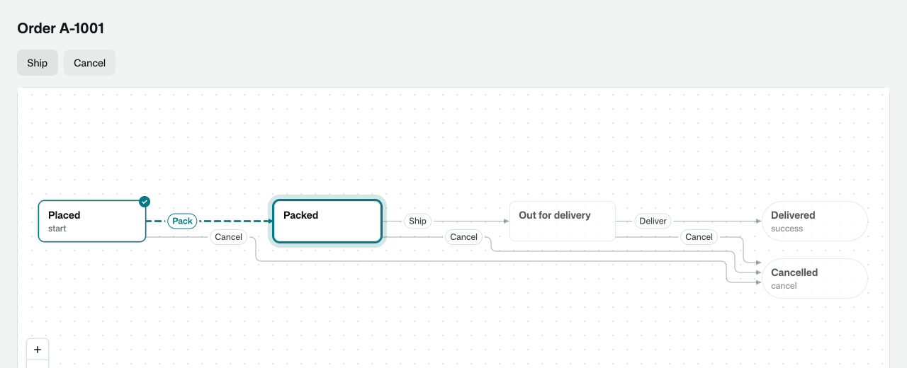
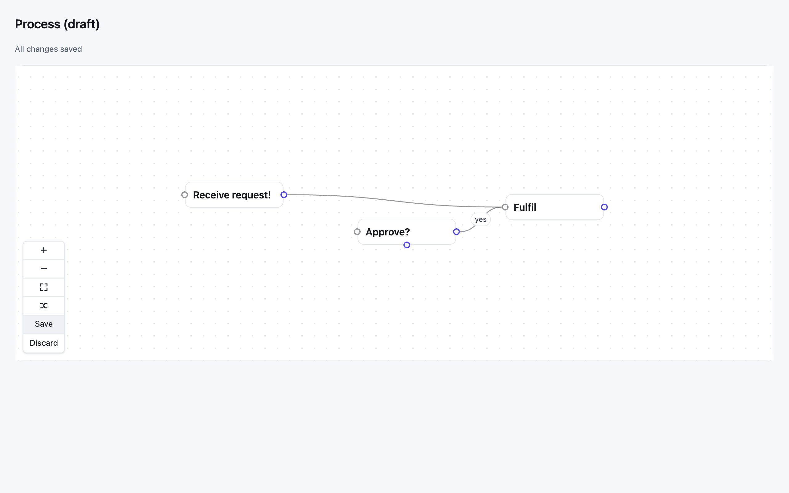

# Osysharp.Diagrams — a node-and-edge canvas whose nodes are your own Osy#

Boxes joined by arrows — drawn for you as a clean picture, or moved, connected and laid out by the people who use your
app, by mouse and by keyboard. Every node is drawn by a template you write in Osy#, and every node and edge is one of
your app's own rows or values. The gestures are React Flow's framework-free core (`@xyflow/system`, MIT); the layout
and the edge routing are the kit's own. There is no React in it.

## Use case

Anything that is a **process** or a **structure**: the stages of a guided process a support desk edits, an approval
chain, the steps of an automation rule, hiring stages, an org chart — and a **live picture of any workflow**, with a
run's path drawn over it, moving as the run moves.

**A picture.** Hand the canvas states and transitions with no positions and it lays them out: the starts first and the
ends in the last column, the main path on one straight row, every edge on a line of its own with an arrowhead, a way
back drawn dashed against the flow. Tell it where a run has been and the path it took is drawn heavy, where it is now
is ringed, and everything it has not reached steps back.







On a phone the same picture flows top to bottom; in dark mode it is painted with the same theme tokens; where a run
failed is marked with a broken outline and a bang, not by colour alone.





**An editor.** Because nodes and edges are rows, a move or a new connection is an ordinary edit your action writes
through the unit of work — committed, discarded, undone, secured and synced like any other. Because a node is your own
template, it can hold anything a page can: a field, a badge, a button.









## Install

```osy
// app.osy
app Designer {
  use Osysharp.Ui;
  use Osysharp.Diagrams@0;
  model "model/**/*.osy";
}
```

```console
osy lock      # resolves the package and pins its content address in osyrin.lock
```

## A picture of a process

```osy
using Osysharp.Diagrams;

FlowCanvas(
  nodes: Fulfilment.Graph.States, edges: Fulfilment.Graph.Transitions,   // any workflow — or any list of your own values
  nodeTypes: [ new FlowNodeType { Name = "State", Ports = [
    new FlowPort { Id = "in", Kind = "target", Side = "left" },
    new FlowPort { Id = "out", Kind = "source", Side = "right" } ] } ],
  sourceField: e => e.From, targetField: e => e.To, labelField: n => n.Label, edgeLabelField: e => e.Trigger,
  readOnly: true,
  autoLayout: always,                          // a picture: the canvas places every node and routes every edge
  visited: times.Select(t => t.State).ToList(),// where the run has been, in order
  highlighted: [order.Status.ToString()]       // where it is
) { s =>
  Stack(px: 3, py: 2, minW: "104px", maxW: "152px", bg: Colors.Surface, borderW: 1, border: Colors.Border,
        rounded: s.IsTerminal ? Radius.Pill : Radius.Md) {
    Text(s.Label, fontWeight: FontWeight.Semibold);
  }
}
```

- **It lays itself out** in ranks: starts first, ends last (`IsInitial` / `IsTerminal` on your rows, or name the fields
  with `initialField:` / `terminalField:`), no edge pointing backwards unless it closes a cycle.
- **The main path is one straight row** — from the first start to the first end you list, by the longest way; or name
  it: `mainPath: ["Placed", "Packed", "Shipped", "Delivered"]`.
- **Every edge is its own line**, with rounded corners and an arrowhead. A way back is a dashed *return*; an edge from
  a node to itself is a loop; a label sits on its own edge and never on a node.
- **It fits its box**, and is never enlarged past the size you drew it. `layoutDirection: auto` flows along the page's
  reading direction, and top to bottom when that shows the picture larger — a phone.
- **A run:** `visited` (in order), `highlighted` (where it is), `failed`, and `path` when you know the exact way it
  went. Taken edges are heavier, the current node is ringed, a visited one ticked, a failed one broken-outlined — each
  readable without colour.
- **In words:** beside the canvas, for a screen reader, is the same picture as text — every node in the order it is
  drawn, what it is, and where its edges lead.
- **Give your node template a `maxW:`** and a long name wraps inside its box; with `nodeSizing: equal` (the default)
  the boxes of one picture are then one size.
- **It is the same picture every time.** Nothing in the layout is random; the order you list nodes and edges in breaks
  every tie.

## An editor

```osy
FlowCanvas(
  nodes: steps, edges: links,
  nodeTypes: [ new FlowNodeType { Name = "Task", Ports = [
    new FlowPort { Id = "in", Kind = "target", Side = "left" },
    new FlowPort { Id = "out", Kind = "source", Side = "right" } ] } ],
  labelField: n => n.Title,          // what a screen reader calls each node
  snap: 20, minimap: true,
  nodeMoved: Move, connected: Link, edgeRemoved: Unlink, nodeRemoved: Remove,
  selectionChanged: Selected
) {
  slot Task { s => Text(s.Title); }
}
```

- **Moves and connections are events carrying your rows.** A drop raises `nodeMoved(row, x, y)` once; drawing an edge
  raises `connected(from, to, fromPort, toPort)` and *you* create the edge row.
- **Select many:** Shift/Ctrl/Cmd-click, Shift + drag a box, Ctrl/Cmd + A, Space from the keyboard. Drag, arrows and
  Delete act on the whole selection; `selectionChanged(TNode[], TEdge[])` hands you the rows.
- **Lay it out:** the Tidy button, Shift + L, or the `Layout` command; `autoLayout: initial` places a graph nobody has
  placed yet. Every node that moves is an ordinary `nodeMoved`, so the app keeps — or discards — the result.
- **Undo** is the unit of work: `gesture(label)` comes first in every edit, the app marks there, and Ctrl+Z is
  `UnitOfWork.Undo()`; `UnitOfWork.Discard()` returns every moved, linked and unlinked row.
- **Without a mouse:** Tab between nodes; arrows move; Alt + arrows go to the nearest node; E walks a node's edges and
  S/T jump to an edge's ends; Enter on two ports connects them; Delete removes; `?` reads the keys. Everything that
  happens is announced.
- **It fills the box you give it** (`sizing fill`) — give that box a height.

The full reference is `osy docs ui-flow-kit`; the layout is `osy docs ui-flow-layout`; the workflow graph is
`osy docs workflow-graph`.

## Tests

`tests/` is the kit's own test project. `layout.test.osy` holds the layout to what must be true of a picture, on a
set of fixture graphs — a real supplier qualification, a line, a diamond, a retry loop, two starts, a self-loop, and
twenty states with thirty-five transitions: no two nodes overlap, no edge lies on another or passes through a node,
every edge that is not a return leads to a later rank, the ends share the last rank, the main path is straight, the
crossings are no more than recorded, the same graph is the same picture, and a run marks only the edges it took.
The canvas publishes those counts as probe fields, so your own tests can assert them too:

```osy
Assert.Probe("FlowCanvas", "crossings", 0);
Assert.Probe("FlowCanvas", "mainPath", "Placed > Packed > Shipped > Delivered");
```

`osy test --pixels` runs the same tests in a real browser, wide and on a phone, light and dark, and photographs each.
Everything that needs a pointer — drag, connect, pan and zoom, box select, the keyboard model, the minimap, motion —
is proven in a real Chromium browser against a demo app.

## Source and package

- Declaration: `flow.osy` (`control FlowCanvas<TNode, TEdge>`, `FlowNodeType`, `FlowPort`, `FlowTool`)
- Shim: `flow.ts` → `flow.js` (`osy control build`), stylesheet `flow.css`
- Layout: `layout.ts` — the layered layout and the edge router, with nothing third-party in it
- Chunks: `xyflow-system.js` (XY — `@xyflow/system` 0.0.83 + d3, pinned exactly) and `layered-layout.js` (Layout —
  built from `layout.ts`), both built by `npm run chunks`
- Licences: `LICENSE` (the kit is MIT; the bundled MIT/ISC/BSD-3 texts are reproduced there)
- Package: `Osysharp.Diagrams` 0.x (preview)
