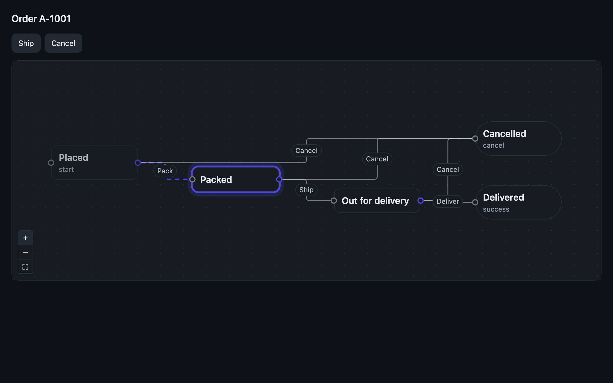

# Osysharp.Diagrams — a node-and-edge canvas whose nodes are your own Osy#

Boxes joined by arrows that people can move, connect, select and lay out — by mouse and by keyboard — where every node
is drawn by a template you write in Osy#, and every node and edge is one of your app's own rows. The drawing and
dragging are React Flow's framework-free core (`@xyflow/system`, MIT); there is no React in it.

## Use case

Anything that is a **process** or a **structure**: the stages of a guided process a support desk edits, an approval
chain, the steps of an automation rule, hiring stages, an org chart — and a **live picture of any workflow**, with a
run's current state highlighted and its path drawn, moving as the run moves.

Because nodes and edges are rows, a move or a new connection is an ordinary edit your action writes through the unit
of work — committed, discarded, secured and synced like any other. Because a node is your own template, it can hold
anything a page can: a field, a badge, a button.





## Install

```osy
// app.osy
app Designer {
  use Osysharp.Ui;
  use Osysharp.Diagrams@0;
  model "model/**/*.osy";
}
```

```console
osy lock      # resolves the package and pins its content address in osyrin.lock
```

## Using it

```osy
using Osysharp.Diagrams;

FlowCanvas(
  nodes: steps, edges: links,
  nodeTypes: [ new FlowNodeType { Name = "Task", Ports = [
    new FlowPort { Id = "in", Kind = "target", Side = "left" },
    new FlowPort { Id = "out", Kind = "source", Side = "right" } ] } ],
  labelField: "Title",          // what a screen reader calls each node
  snap: 20, minimap: true,
  nodeMoved: Move, connected: Link, edgeRemoved: Unlink, nodeRemoved: Remove,
  selectionChanged: Selected
) {
  slot Task { s => Text(s.Title); }
}
```

- **Moves and connections are events carrying your rows.** A drop raises `nodeMoved(row, x, y)` once; drawing an edge
  raises `connected(from, to, fromPort, toPort)` and *you* create the edge row.
- **Select many:** Shift/Ctrl/Cmd-click, Shift + drag a box, Ctrl/Cmd + A, Space from the keyboard. Drag, arrows and
  Delete act on the whole selection; `selectionChanged(TNode[], TEdge[])` hands you the rows.
- **Lay it out:** the Tidy button, Shift + L, or the `Layout` command; `autoLayout: initial` places a graph nobody has
  placed yet, `always` lays out a picture every time. The engine (dagre, MIT) is a separate chunk, downloaded only
  the first time a canvas lays itself out.
- **Undo** is the unit of work: write without committing, and `UnitOfWork.Discard()` returns every moved, linked
  and unlinked row — the canvas draws the rows, so it shows what they are.
- **A workflow's picture:** `nodes: MyFlow.Graph.States, edges: MyFlow.Graph.Transitions`, `highlighted: [row.Status.ToString()]`,
  `visited:` from `MyFlow.For(row).TimeInStates`.
- **Without a mouse:** Tab between nodes; arrows move; Alt + arrows go to the nearest node; E walks a node's edges and
  S/T jump to an edge's ends; Enter on two ports connects them; Delete removes; `?` reads the keys. Everything that
  happens is announced.
- **It fills the box you give it** (`sizing fill`) — give that box a height.

The full reference is `osy docs ui-flow-kit`; the workflow graph is `osy docs workflow-graph`.

## Tests

`tests/` is the kit's own test project: rows become nodes, the selection starts empty, a workflow's graph is complete
and draws. Everything that needs a real compositor — drag, connect, pan and zoom, box select, the keyboard model, the
minimap, auto-layout, motion, dark mode, the live workflow picture — is proven in a real Chromium browser against a
demo app.

## Source and package

- Declaration: `flow.osy` (`control FlowCanvas<TNode, TEdge>`, `FlowNodeType`, `FlowPort`, `FlowTool`)
- Shim: `flow.ts` → `flow.js` (`osy control build`), stylesheet `flow.css`
- Chunks: `xyflow-system.js` (XY — `@xyflow/system` 0.0.83 + d3) and `dagre-layout.js` (Layout — `@dagrejs/dagre`
  3.1.1), built by `npm run chunks`; both pinned exactly
- Licences: `LICENSE` (the kit is MIT; the bundled MIT/ISC/BSD-3 texts are reproduced there)
- Package: `Osysharp.Diagrams` 0.x (preview)
